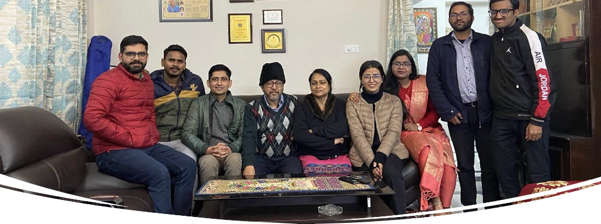
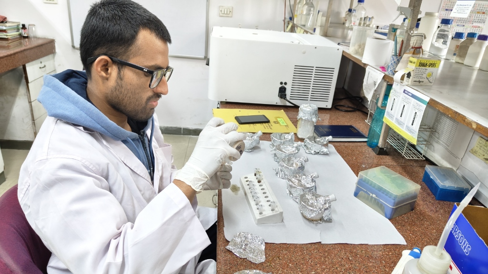
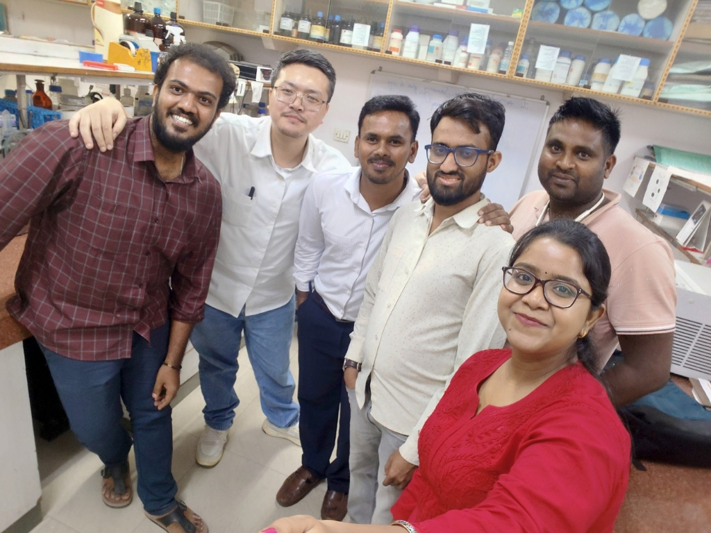
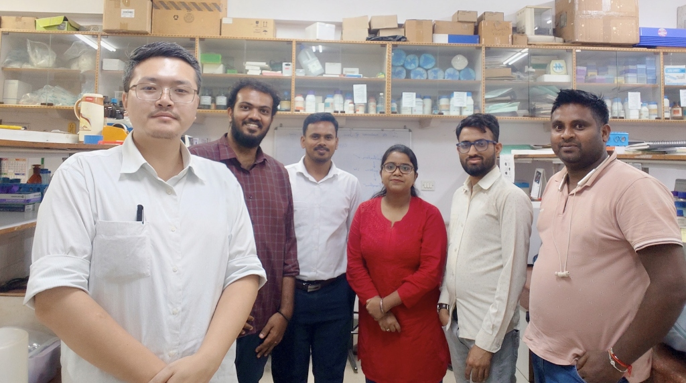

# CitrusTristezaDB (CTV-IndiaAtlas)
### Pan-India *Citrus tristeza virus* Genomic, Lineage & Geospatial Surveillance Portal
**Laboratory 60 — Advanced Centre for Plant Virology (ACPV)**  
**Division of Plant Pathology, ICAR-Indian Agricultural Research Institute (IARI), New Delhi – 110012, India**  
**Authors:** Lalit Pandurang Patil¹, Shaivya Singh¹, Halima Khatoon¹, Bharat Raj Meena², Marimuthu Elangovan¹, Susheel Kumar Sharma¹, Ngawang Namgey¹, Chandrakesh Gautam¹, Anandu S¹, and Kajal Kumar Biswas¹*  
*(¹ ACPV, Division of Plant Pathology, ICAR-IARI, New Delhi; ² Division of Plant Pathology, ICAR-IARI, New Delhi)*  
**Lead Author:** Lalit Pandurang Patil (`lp3436520@gmail.com`)  
**Principal Investigator & Head:** Dr. Kajal Kumar Biswas (`kkbiswas@iari.res.in`)*  

[](https://lalitpatil36.github.io/citrus-tristeza-db/)
[](https://www.ncbi.nlm.nih.gov)
[](https://creativecommons.org/licenses/by/4.0/)

---

## 1. Executive Summary & Purpose

**CitrusTristezaDB** (also designated **CTV-IndiaAtlas**) is an interactive, publication-grade web application and curated comparative genomics database for ***Citrus tristeza virus* (CTV)** collected across commercial citrus agro-ecosystems in India.

The portal provides:
- **118 Curated Sequences**: 34 primary field contigs deposited in NCBI GenBank (`PZ429898`–`PZ429914` and `PQ568311`–`PQ568327`), 49 sequences from Northeast India (Assam Khasi mandarin, Meghalaya, Arunachal Pradesh, Nagaland, Manipur, Kalimpong), 31 from Central India (Vidarbha Nagpur mandarin belt), 22 from South India (Telangana & Andhra Pradesh), 5 from North India (New Delhi), and 11 global reference lineages.
- **Multi-Dimensional Matrix Filtering**: Live multi-criteria sorting across **Region-wise**, **Gene-wise** (CP, p23, ORF1a), **Genotype-wise** (K10, VT, T30, T36, BHKM, Recombinant), **Varieties-wise** (Khasi mandarin, Nagpur mandarin, Kagzi lime, Mosambi sweet orange), and **Lab 60 origin**.
- **Real High-Resolution GIS Satellite Epidemiology Map**: Interactive multi-basemap view powered by **Esri World Imagery + Hybrid Boundaries & Labels**, topographic physical relief, and 23 real GPS survey orchards with disease incidence (%), severity (PDI %), and symptoms.
- **Sequence Alignment, SNP & Amino Acid Scanner**: Base-by-base nucleotide browser, transition/transversion (Ts/Tv) analysis, pair identity calculation, and **codon frame 1 amino acid translation** highlighting synonymous vs non-synonymous mutations.
- **Phylogenomics & Recombination Architecture**: Maximum-likelihood clade segregation and visual schematic of the chimeric crossover breakpoint in South India sweet orange isolate `NGSWO` [PZ429909] (VT × T30).
- **Diagnostic Primers Suite**: Validated Triplex RT-qPCR and RT-PCR primer pairs targeting CP (ORF 7), p23 (ORF 11), and RdRp (ORF 1b) for citrus nursery certification, strain differentiation, and quarantine phytosanitary indexing.
- **Laboratory 60 Team Gallery**: Archival photos of Head & PI Dr. Kajal Kumar Biswas, lead author Lalit Pandurang Patil, and research scholars at ICAR-IARI.
- **Direct Multi-Format Export Center**: One-click download of selected sequences in **FASTA with Lab 60 Citations**, **Standard Clean FASTA**, **GenBank (.gbk)**, **Excel/CSV**, **BibTeX (.bib)**, **RIS (.ris)**.

---

## 2. Laboratory 60 Research Team Gallery

| Leadership & Group Gathering | Molecular Diagnostics & RT-qPCR Benchwork |
| :---: | :---: |
|  |  |
| **Principal Investigator Dr. Kajal Kumar Biswas** (sitting center) with Mrs. Biswas and Lab 60 research scholars at ICAR-IARI, New Delhi. | **Lead Author Lalit Pandurang Patil** conducting total viral RNA isolation and RT-qPCR diagnostic validations. |

| ACPV Molecular Virology Scholars | Lab 60 Virology Team |
| :---: | :---: |
|  |  |
| Doctoral candidates and researchers investigating CTV strain diversity and recombination. | Laboratory associates collaborating on citrus budwood certification and diagnostic surveillance. |

---

## 3. Dataset & Sequence Breakdown

| Category | Count | Classification Details |
| :--- | :---: | :--- |
| **Total Curated Sequences** | **118** | CP (38), p23 (28), ORF1a Diagnostic (52) |
| **Northeast India Isolates** | **49** | Assam (Kahikuchi, Tinsukia, Jorhat, Barak Valley, Boko), Meghalaya (Cherrapunji/Sohra), Arunachal Pradesh, Nagaland, Manipur, Kalimpong |
| **Central India Isolates** | **31** | Maharashtra (Vidarbha citrus belt: Nagpur, Katol, Yenwa, Amravati, Kalam) |
| **South India Isolates** | **22** | Telangana (Nalgonda) & Andhra Pradesh (Tirupati, Nellore) |
| **North India Isolates** | **5** | New Delhi (ICAR-IARI experimental citrus blocks) |
| **Global Reference Lineages** | **11** | VT, T36, T30, RB-G90, B165, HA16-5, K10 |
| **Lab 60 Primary GenBank Contigs** | **34** | `PZ429898`–`PZ429914` (17 contigs) & `PQ568311`–`PQ568327` (17 contigs) |
| **Lab 60 Historical References** | **40** | `KC541317`–`KC541332`, `HM573450`–`HM573451`, `HM210996`–`HM210998`, `JN997475`–`JN997486`, `DQ171598`–`DQ171599` |
| **Real Survey Orchards (GPS)** | **23** | Continuous ground surveillance with incidence (%) and severity (PDI %) |

---

## 4. How to Launch & Host Online

### Option A: Direct Offline Launch (No Server Required)
Double-click `index.html` or open from terminal:
```bash
open /Users/lalit/Virus-internal-control/index.html
```

### Option B: Local Python HTTP Server
```bash
cd /Users/lalit/Virus-internal-control
python3 -m http.server 8000
```
Then visit **`http://localhost:8000`** in any web browser.

### Option C: Publish to GitHub & Host Online (GitHub Pages)
1. Double-click **`PUSH_TO_GITHUB.command`** (or execute `./PUSH_TO_GITHUB.command` in terminal).
2. Go to your repository settings: `https://github.com/lalitpatil36/citrus-tristeza-db/settings/pages`.
3. Set Source to **Deploy from a branch** &rarr; **main** &rarr; **/(root)** &rarr; **Save**.
4. Your portal is live worldwide at: **`https://lalitpatil36.github.io/citrus-tristeza-db/`**.

---

## 5. Peer-Reviewed Research Publications (27 Verified Works from 2005 to 2026)

All 27 peer-reviewed papers authored by Laboratory 60 (Dr. Kajal Kumar Biswas, Lalit Pandurang Patil, Halima Khatoon, Shaivya Singh, et al.) are indexed in CitrusTristezaDB with clickable DOIs, PubMed IDs, and direct article links:

### 2024–2026 Recent Works
1. **Patil, L. P., Singh, S., Khatoon, H., Meena, B. R., Elangovan, M., Sharma, S. K., Namgey, N., Gautam, C., Anandu, S., & Biswas, K. K.* (2026).** *Pan-India Comparative Genomics, Spatial Incidence Mapping, and Lineage Segregation of Citrus tristeza virus (CTV) Infecting Commercial Orchards across Central, South, and North India.* Laboratory 60, ACPV, ICAR-IARI. [Portal](https://github.com/lalitpatil36/CitrustristezaDB).
2. **Singh, S., Khatoon, H., Patil, L. P., Meena, B. R., Elangovan, M., Sharma, S. K., & Biswas, K. K.* (2026).** *Identification of mild cross protecting virus strain for management of citrus decline of Khasi mandarin (Citrus reticulata) caused by Citrus tristeza virus.* *Journal of Plant Biochemistry and Biotechnology*, 35(2): 589–598. DOI: [10.1007/s13562-025-01021-3](https://doi.org/10.1007/s13562-025-01021-3).
3. **Khatoon, H., Singh, S., Chavan, D. D., Elangovan, M., Meena, B. R., Patil, L. P., & Biswas, K. K.* (2026).** *Identification of virus and greening bacteria-free Khasi mandarin mother stock and development of strategy for the production of planting materials for Northeast India.* *Indian Phytopathology*, 79(3): 805–816. DOI: [10.1007/s42360-026-00993-z](https://doi.org/10.1007/s42360-026-00993-z).
4. **Singh, S., Patil, L. P., Namgey, N., Khatoon, H., Meena, B. R., & Biswas, K. K.* (2026).** *Bayesian phylodynamic and phylogeographic analysis reveals the evolutionary dynamics and dispersal patterns of Citrus tristeza virus (CTV) in India based on the coat protein (p25) gene.* *VirusDisease*. DOI: [10.1007/s13337-026-00991-9](https://doi.org/10.1007/s13337-026-00991-9).
5. **Khatoon, H., Chavan, D. D., Meena, V. K., Kashyap, A. S., Sathiyaseelan, K., Elangovan, M., Patil, L. P., Meena, B. R., Gauns, A., Bhattacharyya, U. K., & Biswas, K. K.* (2025).** *Differentiation and validation of mild and severe strains of citrus tristeza virus through codon usage bias, host adaptation, and biochemical profiling.* *Frontiers in Microbiology*, 16: 1665893. DOI: [10.3389/fmicb.2025.1665893](https://doi.org/10.3389/fmicb.2025.1665893) • [PubMed: 41103763](https://pubmed.ncbi.nlm.nih.gov/41103763/) • [PMC12521140](https://www.ncbi.nlm.nih.gov/pmc/articles/PMC12521140/).
6. **Halima, K., Marimuthu, E., Singh, S., Meena, B. R., Patil, L. P., Dharmappa, D. C., & Biswas, K. K.* (2025).** *Genetic recombination and diversity analysis reveal novel strain of Citrus tristeza virus (Closterovirus tristezae) in Khasi mandarin growing region of Assam.* *Plant Science Today*, 12(3). DOI: [10.14719/pst.7546](https://doi.org/10.14719/pst.7546).
7. **Gautam, C., Khatoon, H., Singh, S., Elangovan, M., Patil, L. P., Meena, B. R., & Biswas, K. K.* (2024).** *Citrus tristeza virus causing decline in Assam lemon (Citrus limon) in Northeast India and development of strategy for production of virus-free planting material.* *Agricultural Mechanization in Asia, Africa and Latin America*, 55(12): 19923–19936.

### 2018–2023 Genomics & Diagnostics
8. **Borah, M., Deb Nath, P., Pal Choudhury, S., Biswas, K. K.*, & Ghosh, D. K. (2023).** *Topical application of dsRNAs targeting Citrus tristeza virus (CTV) reduces its titer in the CTV infected sweet orange (Citrus sinensis).* *European Journal of Plant Pathology*, 168(2): 273–278. DOI: [10.1007/s10658-023-02752-6](https://doi.org/10.1007/s10658-023-02752-6).
9. **Biswas, K. K.*, Keremane, M. L., Marais, L. J., Ramadugu, C., & Lee, R. F. (2022).** *Population dynamics of Citrus tristeza virus (CTV) in single aphid-transmitted sub-isolates of the South African GFMS12 isolate.* *Frontiers in Plant Science*, 13: 1024556. DOI: [10.3389/fpls.2022.1024556](https://doi.org/10.3389/fpls.2022.1024556) • [PubMed: 36388600](https://pubmed.ncbi.nlm.nih.gov/36388600/).
10. **Ghosh, D. K., Kokane, A. D., Kokane, S. B., Mukherjee, K., Tenzin, J., Surwase, D., Deshmukh, D., Gubyad, M., & Biswas, K. K.* (2022).** *A Comprehensive Analysis of Citrus Tristeza Variants of Bhutan and Across the World.* *Frontiers in Microbiology*, 13: 797463. DOI: [10.3389/fmicb.2022.797463](https://doi.org/10.3389/fmicb.2022.797463) • [PubMed: 35464978](https://pubmed.ncbi.nlm.nih.gov/35464978/).
11. **Kokane, S. B., Kokane, A. D., Misra, P., Warghane, A. J., Kumar, P., Sharma, A. K., Biswas, K. K., & Ghosh, D. K.* (2020).** *In-silico characterization and RNA-binding protein based polyclonal antibodies production for detection of citrus tristeza virus.* *Molecular and Cellular Probes*, 54: 101654. DOI: [10.1016/j.mcp.2020.101654](https://doi.org/10.1016/j.mcp.2020.101654) • [PubMed: 32866661](https://pubmed.ncbi.nlm.nih.gov/32866661/).
12. **Ghosh, D. K., Warghane, A., & Biswas, K. K.* (2019).** *Rapid and Sensitive Detection of Citrus tristeza virus Using Reverse Transcription Loop-Mediated Isothermal Amplification (RT-LAMP) Assay.* *Methods in Molecular Biology*, 2015: 143–150. DOI: [10.1007/978-1-4939-9558-5_10](https://doi.org/10.1007/978-1-4939-9558-5_10) • [PubMed: 31222701](https://pubmed.ncbi.nlm.nih.gov/31222701/).
13. **Biswas, K. K.*, Palchoudhury, S., Chakraborty, P., Bhattacharyya, U. K., Ghosh, D. K., Debnath, P., Ramadugu, C., Keremane, M. L., Khetarpal, R. K., & Lee, R. F. (2019).** *Codon Usage Bias Analysis of Citrus tristeza Virus: Higher Codon Adaptation to Citrus reticulata Host.* *Viruses*, 11(4): 331. DOI: [10.3390/v11040331](https://doi.org/10.3390/v11040331) • [PubMed: 30965565](https://pubmed.ncbi.nlm.nih.gov/30965565/).
14. **Biswas, K. K.*, Palchoudhury, S., Sharma, S. K., Saha, B., Godara, S., Ghosh, D. K., & Keremane, M. L. (2018).** *Analyses of 3' half genome of citrus tristeza virus reveal existence of distinct virus genotypes in citrus growing regions of India.* *VirusDisease*, 29(3): 308–315. DOI: [10.1007/s13337-018-0456-2](https://doi.org/10.1007/s13337-018-0456-2) • [PubMed: 30159365](https://pubmed.ncbi.nlm.nih.gov/30159365/).

### 2010–2017 Diversity & Recombination
15. **Warghane, A., Misra, P., Bhose, S., Biswas, K. K., Sharma, A. K., & Ghosh, D. K.* (2017).** *Development of a simple and rapid reverse transcription-loop mediated isothermal amplification (RT-LAMP) assay for sensitive detection of Citrus tristeza virus.* *Journal of Virological Methods*, 250: 6–10. DOI: [10.1016/j.jviromet.2017.09.018](https://doi.org/10.1016/j.jviromet.2017.09.018) • [PubMed: 28941614](https://pubmed.ncbi.nlm.nih.gov/28941614/).
16. **Biswas, K. K.*, Tarafdar, A., & Sharma, S. K. (2014).** *Current status of Citrus tristeza virus incidence and its spatial distribution in citrus growing geographical zones of India.* *Indian Journal of Agricultural Sciences*, 84(2): 184–189. DOI: [10.56093/ijas.v84i2.38028](https://epubs.icar.org.in/index.php/IJAgS/article/view/38028).
17. **Biswas, K. K.*, Godara, S., & Nayak, D. (2014).** *Distribution of Citrus tristeza virus in the Darjeeling hills and their biological symptoms in mandarin orchards.* *Indian Journal of Horticulture*, 71(3): 408–411. [Link](https://www.indianjournals.com/ijor.aspx?target=ijor:ijh&volume=71&issue=3&article=021).
18. **Singh, J. K., Tarafdar, A., Sharma, S. K., & Biswas, K. K.* (2013).** *Evidence of recombinant Citrus tristeza virus isolate occurring in acid lime cv. Pant Lemon orchard in Uttarakhand Terai region of Northern Himalaya in India.* *Indian Journal of Virology*, 24(1): 35–41. DOI: [10.1007/s13337-012-0118-8](https://doi.org/10.1007/s13337-012-0118-8) • [PubMed: 24426255](https://pubmed.ncbi.nlm.nih.gov/24426255/).
19. **Tarafdar, A., Godara, S., Dwivedi, S., Jayakumar, B., & Biswas, K. K.* (2013).** *Characterization of Citrus tristeza virus and determination of genetic variability in North-east and South India.* *Indian Phytopathology*, 66(3): 302–307. [Link](https://epubs.icar.org.in/index.php/IPP/article/view/33420).
20. **Biswas, K. K.*, Tarafdar, A., & Sharma, S. K. (2012).** *Complete genome sequence of mandarin decline Citrus tristeza virus of the Northeastern Himalayan hill region of India: comparative analyses determine recombinant.* *Archives of Virology*, 157(3): 579–583. DOI: [10.1007/s00705-011-1165-y](https://doi.org/10.1007/s00705-011-1165-y) • [PubMed: 22160128](https://pubmed.ncbi.nlm.nih.gov/22160128/).
21. **Biswas, K. K.*, Tarafdar, A., Diwedi, S., & Lee, R. F. (2012).** *Distribution, genetic diversity and recombination analysis of Citrus tristeza virus of India.* *Virus Genes*, 45(1): 139–148. DOI: [10.1007/s11262-012-0748-3](https://doi.org/10.1007/s11262-012-0748-3) • [PubMed: 22562224](https://pubmed.ncbi.nlm.nih.gov/22562224/).
22. **Sharma, S. K., Tarafdar, A., Khatun, D., Roy, A., & Biswas, K. K.* (2012).** *Intra-farm diversity and evidence of genetic recombination of Citrus tristeza virus in Delhi region of India.* *Journal of Plant Biochemistry and Biotechnology*, 21(1): 38–43. DOI: [10.1007/s13562-011-0071-4](https://doi.org/10.1007/s13562-011-0071-4).
23. **Biswas, K. K.*, Tarafdar, A., & Diengdoh, L. C. (2010).** *Molecular characterization of Citrus tristeza virus isolates from the Northeastern Himalayan region of India.* *Archives of Virology*, 155(6): 959–963. DOI: [10.1007/s00705-010-0602-7](https://doi.org/10.1007/s00705-010-0602-7) • [PubMed: 20437063](https://pubmed.ncbi.nlm.nih.gov/20437063/).

### 2005–2009 Foundational Works
24. **Biswas, K. K.*, Tarafdar, A., Jayakumar, B., & Pun, K. B. (2009).** *Strategy for the production of Citrus tristeza virus-free mandarin (Citrus reticulata) planting materials in the Darjeeling hills of India.* *Indian Phytopathology*, 62(3): 376–380. [Link](https://epubs.icar.org.in/index.php/IPP/article/view/21190).
25. **Biswas, K. K.* (2008).** *Molecular diagnosis of Citrus tristeza virus in mandarin (Citrus reticulata) orchards of Darjeeling hills of West Bengal.* *Indian Journal of Virology*, 19(1): 26–31. [Link](https://www.researchgate.net/publication/285906236_Molecular_diagnosis_of_Citrus_tristeza_virus_in_mandarin_Citrus_reticulata_orchards_of_Darjeeling_hills_of_West_Bengal).
26. **Biswas, K. K.* (2008).** *Molecular characterization of Citrus tristeza virus isolates from different citrus growing zones of India.* *Indian Phytopathology*, 61(2): 230–238. DOI: [10.56093/ip.v61i2.14820](https://epubs.icar.org.in/index.php/IPP/article/view/14820).
27. **Roy, A., Biswas, K. K.*, & Ahlawat, Y. S. (2005).** *Biological and molecular characterization of Citrus tristeza virus isolates in India.* *Indian Phytopathology*, 58(4): 435–442. DOI: [10.56093/ip.v58i4.10214](https://epubs.icar.org.in/index.php/IPP/article/view/10214).

*Complete bibliography with full abstract summaries and metadata: see [lab60_ctv_research_citations.md](lab60_ctv_research_citations.md) and [lab60_biswas_ctv_publications.bib](lab60_biswas_ctv_publications.bib).*

---

## 6. Citation

If you use **CitrusTristezaDB** in your research, diagnostics, or breeding programs, please cite:

> **Lalit Pandurang Patil¹**, **Shaivya Singh¹**, **Halima Khatoon¹**, **Bharat Raj Meena²**, **Marimuthu Elangovan¹**, **Susheel Kumar Sharma¹**, **Ngawang Namgey¹**, **Chandrakesh Gautam¹**, **Anandu S¹**, and **Kajal Kumar Biswas¹\*** (2026).  
> *CitrusTristezaDB: Pan-India Citrus tristeza virus Genomic, Lineage & Geospatial Surveillance Portal (v2.5).*  
> Laboratory 60, Advanced Centre for Plant Virology (ACPV), Division of Plant Pathology, ICAR-Indian Agricultural Research Institute (IARI), New Delhi – 110012, India.  
> Portal: [https://lalitpatil36.github.io/citrus-tristeza-db/](https://lalitpatil36.github.io/citrus-tristeza-db/) • Repository: [https://github.com/lalitpatil36/citrus-tristeza-db](https://github.com/lalitpatil36/citrus-tristeza-db).

*Standard Bibliographic Format:*
> **Patil, L. P., Singh, S., Khatoon, H., Meena, B. R., Elangovan, M., Sharma, S. K., Namgey, N., Gautam, C., Anandu, S., & Biswas, K. K.\* (2026).** *CitrusTristezaDB: Pan-India Citrus tristeza virus Genomic, Lineage & Geospatial Surveillance Portal (v2.5).* Advanced Centre for Plant Virology, Division of Plant Pathology, ICAR-Indian Agricultural Research Institute, New Delhi, India. [https://github.com/lalitpatil36/citrus-tristeza-db](https://github.com/lalitpatil36/citrus-tristeza-db).
